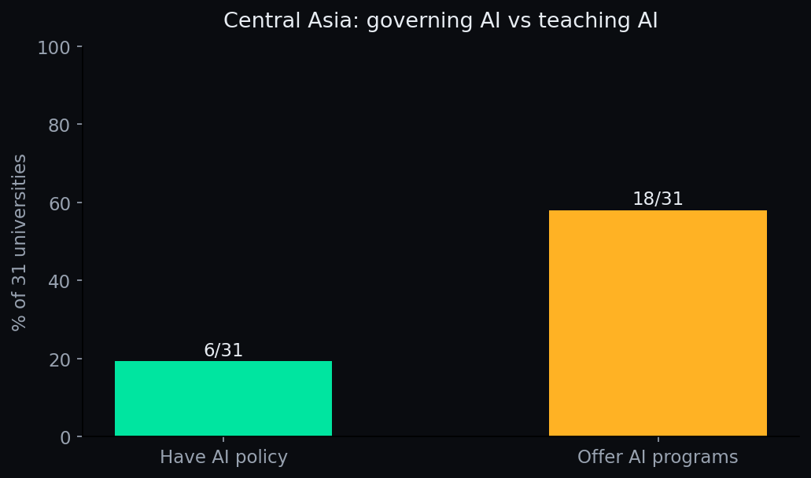

# Central Asia AI Education Audit 2026

> **Atlanta College of Liberal Arts and Sciences (ACLAS)** — published as part of [Study Intelligence](https://aclas.si), the university's open research program · [aclas.college](https://aclas.college)


An open dataset of **31 leading universities across Kazakhstan, Kyrgyzstan,
Uzbekistan, Tajikistan and Turkmenistan**, audited on two questions:
(a) does it publish a public, university-level AI usage policy?
(b) what AI-related degree programs or courses does it offer?


> **Also on Kaggle:** [aclascollege/central-asia-ai-education-audit-2026](https://www.kaggle.com/datasets/aclascollege/central-asia-ai-education-audit-2026) — download the CSV without git, or fork it straight into a notebook.

## In plain English

**What is this?** A report card for 31 leading universities in Kazakhstan,
Kyrgyzstan, Uzbekistan, Tajikistan and Turkmenistan on two questions: *do
they publish AI rules?* and *do they teach AI?*

**The headline:**



Schools are teaching AI **three times faster** than they're writing rules
for it (58% offer AI programs vs 19% with a policy). And four of the six
schools *with* policies are in Kazakhstan — Turkmenistan and Tajikistan are
near-complete blind spots.

## Try it (30 seconds)

```python
import pandas as pd
df = pd.read_csv("central-asia-ai-policies-2026.csv")
print(df["has_policy"].value_counts())
```

## FAQ

**Why Central Asia?** It's the least-measured region in global AI-education
research. English-only surveys systematically miss it — this audit searched
in Russian and local languages too.

**What does UNVERIFIABLE mean?** We couldn't confirm a policy on the public
web — often because sites are down, login-walled, or crawler-blocked. It's
a finding about *transparency*, not just adoption.

## Headline numbers

- **6 of 31 (19%)** publish a verifiable public AI usage policy on their official
  domain — 3 of the 6 are Kazakh, backed by a 2024 inter-university AI standard
  and a 2025 ministry position against AI bans.
- **18 of 31 (58%)** offer a verifiable AI-named degree program or AI course
  portfolio — institutions are teaching AI ~3× faster than they govern its use.
- **Zero** campus-wide AI bans. Every verified policy follows the global norm of
  *delegated permission plus mandatory disclosure*.
- **Turkmenistan and Tajikistan are near-complete blind spots:** 0 of 7 sampled
  universities publish a verifiable policy.
- The **UNVERIFIABLE rate (81%) is the highest of any region measured** — a finding
  about transparency and discoverability as much as about adoption.

## Files

| File | Description |
|---|---|
| `central-asia-ai-policies-2026.csv` / `.json` | 31 rows: AI policy per university |
| `central-asia-ai-programs-2026.csv` | 31 rows: verified AI programs/courses per university |
| `central-asia-ai-education-audit-2026.json` | Both tables + metadata |
| `METHODOLOGY.md` | Sample selection, definitions, caveats |
| `parse.py` | Script that generated CSV/JSON from the audit tables (source tables not shipped; not independently reproducible from this repo alone) |

## Columns — policies

`id`, `country_code` (KZ/KG/UZ/TJ/TM), `university`, `has_policy`
(`YES`/`UNVERIFIABLE` — no confirmed-NO cases in this sample; unverifiable means
not found, not proven absent), `policy_url`, `policy_url_raw`, `note`.

## Columns — programs

`id`, `university`, `has_ai_programs` (`true`/`false` — machine-readable flag;
13 rows are "None verified"), `ai_programs` (verified AI-named programs/courses),
`source_url`, `source_url_raw`.

## Notes

- Snapshot date: **2026-10-17**. QAIRU (Qazaq AI Research University, Central
  Asia's first purpose-built AI university) enrolled its first 528 students in
  September 2026 — included where verifiable.
- Corrections welcome via issues/PRs.

## License

[CC-BY-4.0](LICENSE) — cite "Atlanta College of Liberal Arts and Sciences (ACLAS) — Study Intelligence (aclas.si)".

---
Published by the **Atlanta College of Liberal Arts and Sciences (ACLAS)** as part of [Study Intelligence](https://aclas.si), an open research program on AI and higher education.
